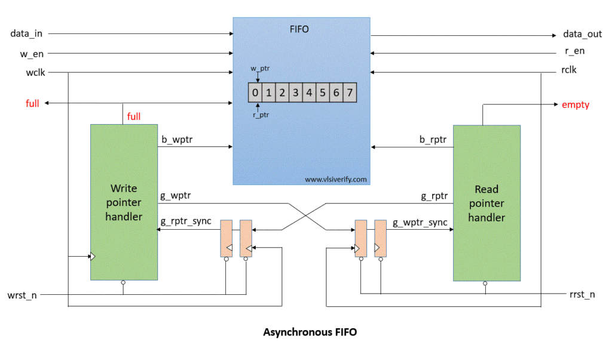
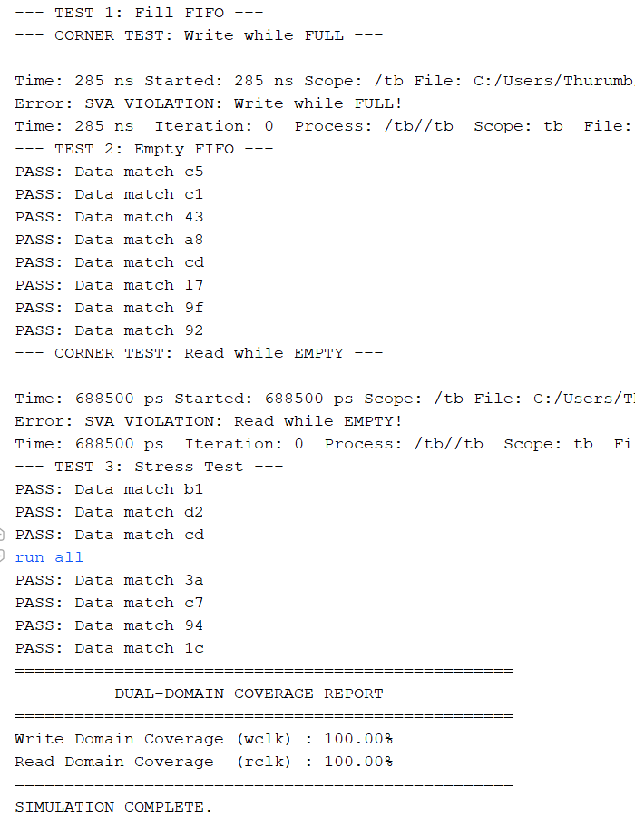
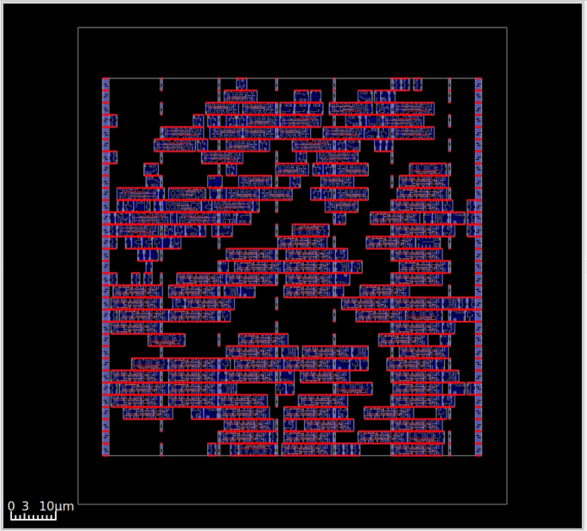
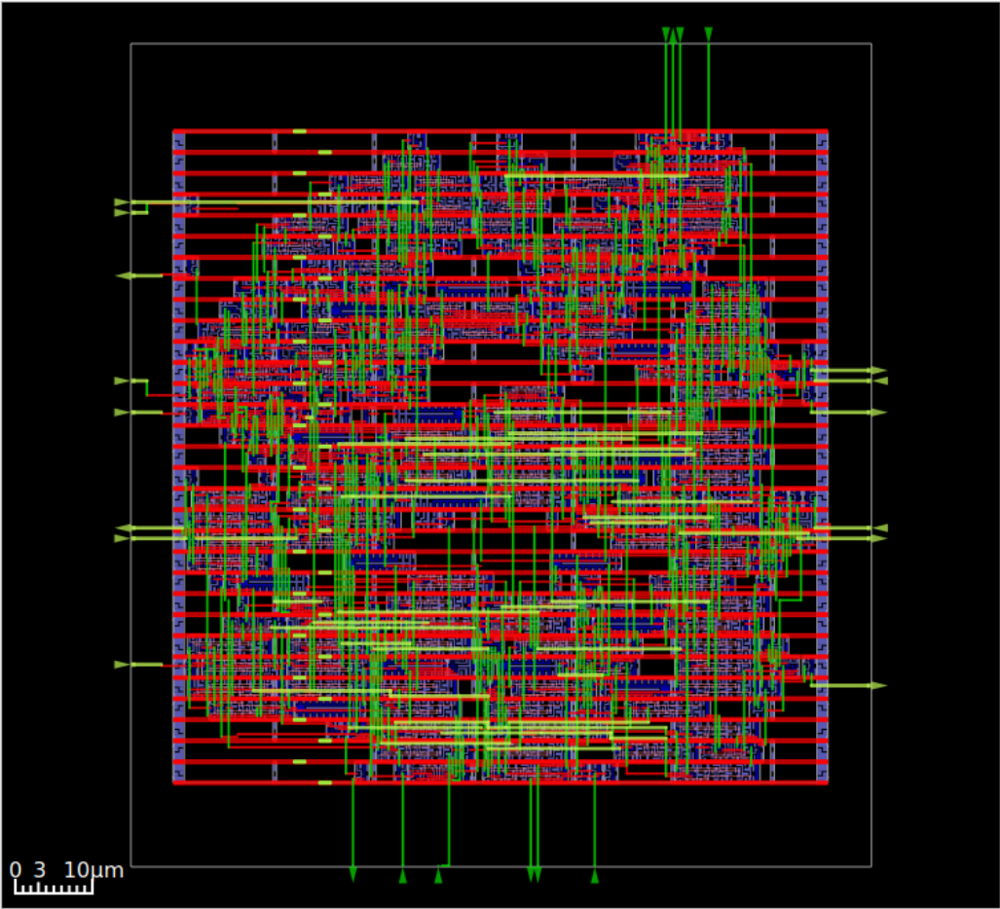
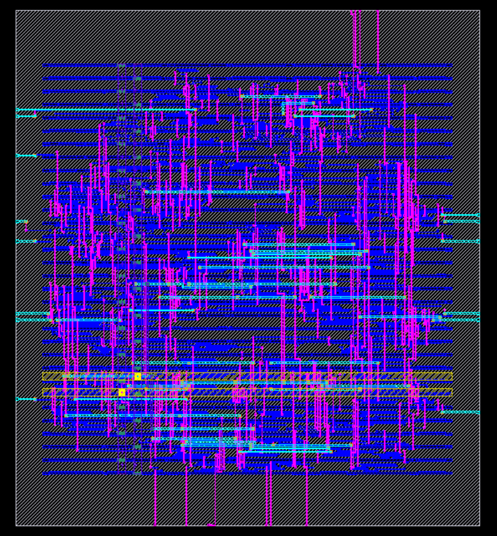

# Asynchronous FIFO with Clock Domain Crossing (CDC)

A dual-clock Asynchronous FIFO (8-depth × 8-bit) designed in Verilog to safely transfer data across independent clock domains. The design implements First-Word Fall-Through (FWFT) read logic and mitigates metastability by passing Gray-coded read and write pointers through 2-stage flip-flop synchronizers.

<!-- PLACEHOLDER: Insert your Block Diagram image here -->

*Figure 1: High-level architecture showing independent clock domains, Gray code conversion, and 2-stage synchronizers.*

---

## 1. Functional Verification (Front-End)

The RTL was rigorously verified using a self-checking SystemVerilog testbench executed in Xilinx Vivado. 

* **Reference Model Scoreboard:** Automated verification against a golden reference queue to ensure data integrity during simultaneous read/write bursts.
* **SystemVerilog Assertions (SVA):** Concurrent SVAs actively monitor the bus and flag catastrophic failure modes, specifically verifying zero `overflow` (writing while full) and `underflow` (reading while empty) conditions.

<!-- PLACEHOLDER: Insert your Vivado Simulation Waveform / Console output here -->

*Figure 2: Vivado simulation demonstrating FWFT read logic and clean clock domain crossing.*

---

## 2. Physical Design: RTL-to-GDSII (Back-End)

The physical implementation was executed using the **LibreLane / OpenROAD** open-source EDA toolchain targeting the **SkyWater 130nm** High-Density PDK (`sky130_fd_sc_hd`). The automated pipeline handled the complete ASIC flow from synthesis through physical verification.

### Layout Progression

<!-- PLACEHOLDERS: Insert your KLayout/OpenROAD GUI stage exports here -->

| Floorplan & PDN | Placement | Clock Tree Synthesis (CTS) | Detailed Routing (GDS) |
| :---: | :---: | :---: | :---: |
|  |  |  |
| *Die area, I/O pins, and Power Delivery Network (PDN) stripes.* | *Standard cells packed into core rows without routing.* | *Balanced clock buffer insertion for the independent domains.* | *Final metal interconnects and vias.* |

---

## 3. Implementation Metrics (Sky130)

The design successfully achieved timing closure and passed all physical design rule checks. Extracted from the LibreLane sign-off reports:

| Parameter | Value |
| :--- | :--- |
| **Target Technology** | SkyWater 130nm |
| **Core Area** | 7,136.84 µm² |
| **Instance Count (Standard Cells)** | 407 |
| **Core Utilization** | 65.48% |
| **Total Power** | 1.28 mW |
| **Setup Slack (WS)** | + 1.356 ns |
| **Hold Slack (WS)** | + 0.137 ns |
| **Routing DRC Errors** | 0 |
| **LVS & Magic DRC Errors** | 0 |

---

## Repository Structure

```text
├── verilog-code/                  # Verilog HDL source files (FIFO core, RAM, synchronizers)               
├── runs/                 # LibreLane config.json and physical design reports
└── images/               # Architecture diagrams, waveforms, and layout screenshots
